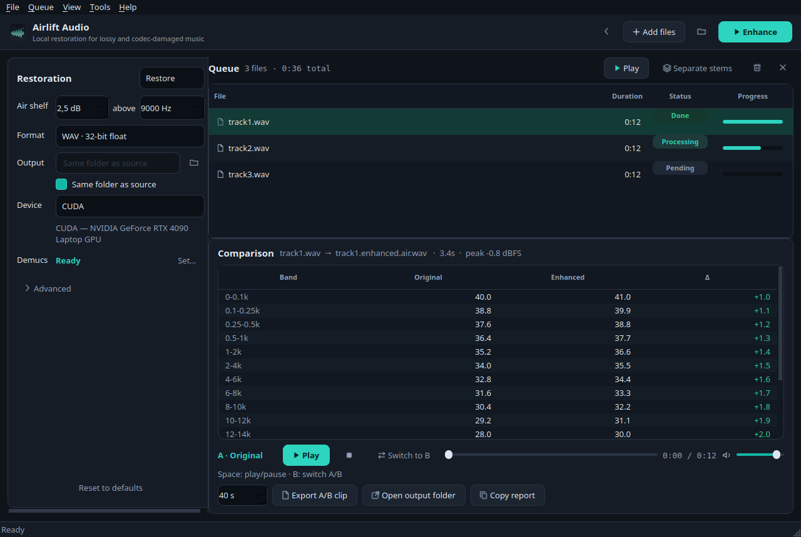

# Airlift Audio

Local AI restoration for lossy and codec-damaged music. Drop in a song that
was encoded at a low bitrate or rendered by a generative model, get back a
clean full-band master — everything runs on your own machine, nothing is
uploaded.




## Why

Lossy masters and generated tracks carry a characteristic "64 kbps" damage:
band-limited mush, codec warble and hiss in quiet passages. Apollo — a
music-specific restoration model trained on 24–128 kbps codec artifacts —
removes that damage and rebuilds high-frequency detail without the
hallucinated edges of a pure super-resolution model.

## Features

- **Apollo restoration** (ICASSP 2025, Tsinghua / Tencent AI Lab), 16.5M
  parameters, 66 MB weights, 44.1 kHz full-band stereo.
- **Chunked inference** with overlap-add, so multi-minute songs process
  without seams.
- **Built-in "air" shelf**: a +2.5 dB high shelf at 9 kHz by default, which
  compensates for Apollo's measurable treble tilt.
- **Batch queue**: add files or a whole folder, process sequentially, cancel
  any time, results are never overwritten silently.
- **A/B listening**: switch between original and enhanced at the same
  position, with loudness-matched clip export and the band-delta table.
- **CPU, CUDA or Apple MPS** — automatic device selection. *Shipped
  installers bundle CPU-only torch; CUDA and MPS work only when you install
  torch with those wheels yourself (see Build from source).*
- **WAV float or 24-bit FLAC** output, side-by-side with the source.
- **CLI**: `airlift-audio enhance`, `compare`, `devices`.

## Download

Requires no separate Python installation. Installers are unsigned (personal
tool), so your OS may ask you to allow the app once.

| Platform | Package |
|---|---|
| Windows 10/11 x64 | `Airlift-Audio-Setup-*.exe` (Inno Setup) |
| macOS 12+ (Apple Silicon) | `Airlift-Audio-*.dmg` |
| Linux (Ubuntu 22.04+) | `*.AppImage` or `*.deb` |

Releases are built in CI from tags. On first run the app downloads the
66 MB model weights and then works offline. The installers are CPU-only
bundles; there is no GPU acceleration in the shipped build.

## Build from source

```bash
git clone https://github.com/<org>/airlift-audio
cd airlift-audio
python -m venv .venv
. .venv/bin/activate
pip install torch --index-url https://download.pytorch.org/whl/cpu   # or cu128 for CUDA
pip install -e .
airlift-audio         # GUI
```

GPU variant: `pip install torch --index-url https://download.pytorch.org/whl/cu128`.

### Run the tests

```bash
pip install -e .[dev]
pytest
```

### Build an installer

```bash
python packaging/check_release.py          # gate: no CUDA leakage into the CPU bundle
python -m PyInstaller packaging/airlift.spec     # one-folder bundle in dist/
# Linux: bash packaging/linux/build_appimage.sh
# macOS: bash packaging/macos/build_dmg.sh
# Windows: packaging/windows/build.ps1
```

## Usage

### GUI

Drag audio files (WAV, FLAC, MP3, M4A, OGG, Opus, AAC, AIFF) onto the
window, press **Enhance**, then listen with the A/B control and read the
band-delta table. The default settings produce `<name>.enhanced.air.wav`
next to the source.

### CLI

```bash
airlift-audio enhance song.mp3                    # -> song.enhanced.air.wav
airlift-audio enhance song.mp3 --shelf 0          # raw model output, no EQ
airlift-audio enhance song.flac --format flac -o out/
airlift-audio enhance ./tracks/ --device auto
airlift-audio compare original.wav enhanced.wav --start 75
airlift-audio devices
```

Every option has a `--help` entry; `airlift-cli` is the same dispatcher —
for example, `airlift-cli devices` prints which backends are available.
Use whichever entry point you have installed.

## Measured behaviour (why the defaults)

On a full 4:54 generated track, Apollo's restoration changed the average
band energy relative to 1–8 kHz by:

| Band | Apollo | Apollo + 2.5 dB shelf |
|---|---|---|
| 8–12 kHz | −2.0 dB | −0.6 dB |
| 12–16 kHz | −2.9 dB | −0.6 dB |
| 16–18 kHz | −5.2 dB | −2.7 dB |
| 18–20 kHz | −7.7 dB | −5.3 dB |
| quiet-frame hiss (10–16 kHz floor) | −7.2 dB | −5.1 dB |

The model preserves the harmonic envelope (correlation 0.995) and stereo
width; it mostly removes broadband mush. The shelf puts presence back while
keeping the cleaner floor. If a track still sounds veiled, raise the air to
3.5 dB; if it sounds bright, drop to 1.5 dB or 0.

## Layout

```
airlift/
  core/        decode, EQ, metrics, Apollo wrapper, pipeline
  ui/          PySide6 window, A/B player, batch worker, theme
  third_party/ Apollo model code (unmodified, CC BY-SA 4.0)
packaging/     PyInstaller spec + per-OS installer scripts
scripts/       icon generation
tests/         core + CLI tests

OWL/ — documentation and specifications live in docs/; screenshots in
docs/screenshot.png
```

## Documentation

- [Measured behaviour & benchmarks](#measured-behaviour-why-the-defaults) — why the
  air shelf is +2.5 dB at 9 kHz, and what Apollo does to real tracks.
- [Credits and licenses](#credits-and-licenses) — MIT app code, CC BY-SA Apollo
  weights and model code.
- [Limitations](#limitations) — 44.1 kHz ceiling, restoration-only scope,
  CPU speed expectations.

## Credits and licenses

- Application code: **MIT** (`LICENSE`).
- Apollo implementation and weights: **CC BY-SA 4.0**,
  Kai Li & Yi Luo, "Apollo: Band-sequence Modeling for High-Quality Audio
  Restoration", ICASSP 2025 (Tsinghua University / Tencent AI Lab).
  Bundled under `airlift/third_party/apollo/` with its own license file.
- Qt / PySide6: LGPLv3. FFmpeg is invoked as an external program.
- No trademarks are used by this project.

## Limitations

- Output is 44.1 kHz, the model's native rate. Material above 22 kHz is not
  possible; generated masters usually contain nothing there anyway.
- Apollo is a restoration model, not a mastering suite: it removes codec
  damage but adds no arrangement, level or dynamics changes.
- CPU inference is roughly 0.5–1× the track length (the bundled installers
  are CPU-only wheels).
